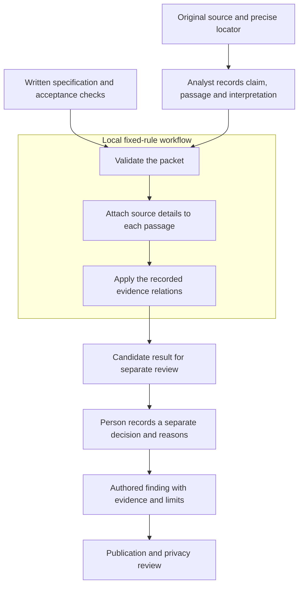

# How the study workflow is organized

[Home](../README.md) / [Start here](START-HERE.ipynb) / Architecture

This repository connects research questions, source passages, annotated claims and recorded review. Readers can inspect the argument without running software. The executable example demonstrates how a fixed set of evidence rules produces a candidate label. AI assistance occurs when sources are inspected, annotations are prepared and prose is drafted. That assistance is documented separately from program execution.

The [Cerrillos memo](../assignments/assignment-04/memo.md) and its [research record](../assignments/assignment-04/research-record.md) describe the case application. The [worked notebook](../methods/evidence-review/trace-a-claim.ipynb) uses fictional records to teach the method. Its output supplies no additional evidence about Cerrillos.

## Follow one claim

The diagram shows responsibilities as well as data flow. The program stops at the candidate packet. A person's review, the writing of a finding and the decision to publish take place outside that graph. Publication permission does not establish source fidelity or an environmental outcome. [Research-integrity protocol](../methods/RESEARCH-INTEGRITY.md) · [Public-sharing policy](../governance/PUBLICATION.md)

The implementation reads a JSON packet. It checks identifiers, required fields, source dates, permitted relations and passage references. LangChain Core's `Document` object keeps each passage with its source, locator and quotation-or-paraphrase designation. LangGraph then runs three named steps in order: `validate`, `prepare_documents` and `evaluate_claims`. There is no semantic source reading inside these steps. [Implementation](../methods/evidence-review/workflow.py)

An analyst supplies whether a passage supports a clause, contradicts it or provides context, together with a reason. The program combines those annotations under the [written rules](../methods/evidence-review/SPEC.md). Every output remains `pending_human_review`. It records the input, implementation and specification fingerprints and dependency versions so another person can reproduce the transformation. A matching fingerprint identifies bytes. It does not establish that a source is authentic or that an annotation is faithful.

## What is implemented

| Component | Repository evidence | Role and boundary |
| --- | --- | --- |
| Reader interface | [Starting notebook](START-HERE.ipynb), [course-reader notebook](FACULTY-GUIDE.ipynb), and [worked example](../methods/evidence-review/trace-a-claim.ipynb) | The first two are explanatory documents. The worked example can execute fictional cases. There is no public chat application or resident service. |
| Evidence and provenance | [Source registry](../cross-course/evidence-registry.json), [case source checks](../research/cerrillos/draft-source-checks.json), and [research record](../assignments/assignment-04/research-record.md) | Source identity, locators, access and review scope are recorded. Older source checks retain their dated scope. Raw restricted materials remain outside Git. |
| Specification and rules | [Evidence-review specification](../methods/evidence-review/SPEC.md), [cases](../methods/evidence-review/cases.json), and [schemas](../schemas/README.md) | Requirements map to acceptance tests. Analyst-supplied relations control the candidate result. The software does not discover whether a passage supports a claim. |
| Orchestration and state | [LangGraph workflow](../methods/evidence-review/workflow.py) | A local sequence carries in-memory state between three functions and emits JSON. The example has no persistent graph checkpoint, autonomous planner or approval action. |
| Research-to-Decision Translator | [Bridge](../methods/TRANSLATOR-BRIDGE.md) and [execution record](../research/course-readings/TRANSLATOR.md) | The study uses its structured research pattern and records executed upstream intake and validation checks. Those operations are distinct from a provider-backed agent runloop. |
| Tests and repository checks | [Workflow tests](../methods/evidence-review/test_workflow.py), [notebook checks](../scripts/check_notebooks.py), [assurance runner](../scripts/assure.py), and [CI workflow](../.github/workflows/validate.yml) | Checks cover specified behavior, structure, traceability and publication constraints. The current [assurance receipt](../governance/evaluation-results.json) identifies the evaluated content. Passing tests are not a measure of research accuracy. |
| Human decisions and governance | [Review protocol](../methods/RESEARCH-INTEGRITY.md), [governance](../governance/AI-GOVERNANCE.md), and [AI disclosure](../methods/AI-DISCLOSURE.md) | Review decisions, author approval and permission to publish have separate meanings. AI-assisted review remains labeled as assisted. Class fidelity gates and case-specific reviews must not be conflated. |
| Operational record | [Activity records](../methods/ai-activity.json), [AI-use log](../AI-USE-LOG.md), and [system register](../methods/AI-SYSTEMS.md) | These identify observed tasks and tool roles. Missing historical prompts, model versions, usage or costs remain unavailable. |

## How the enterprise AI checklist applies

The study currently needs an inspectable research record and a reproducible local demonstration. Components in a larger AI application should be added only when a defined research task requires them.

| Checklist area | Present state | Recommendation |
| --- | --- | --- |
| Model and provider access | Codex and earlier ChatGPT assistance are recorded outside the graph. The graph calls no model. | Keep the system register specific to the activity. Do not describe the notebook as a model-powered reviewer. |
| Prompts and specifications | The graph takes structured data, not a model prompt. Selected recoverable instructions and outputs are documented in the research record. The optional Jev adapter contains its own question instructions. | Retain exact prompts prospectively when permitted, identify retrospective summaries, and version the specification with its tests. A new empty prompts folder would add no evidence. |
| Retrieval and knowledge storage | Files, source links, registries and selected annotations provide context. There is no vector database, embedding pipeline or automated retrieval-augmented generation service. | First test whether readers can find sources through the existing index. Add retrieval only with a bounded task, a source-access policy and an evaluation against known locators. |
| Specialist agents and tools | Collaborating AI agents assisted development and critique. Their work is recorded as AI assistance. No specialist-agent service is shipped in the repository. | Separate a development team of assistants from a deployed research system. Document inputs, outputs and review authority before introducing a new automated role. |
| API and application layer | The workflow is a local Python command and notebook example. No web API, authentication service, background queue or resident-facing register is implemented. | Keep the proposed public response register labeled as a proposal. A deployed pilot would need an agreed custodian, access arrangements, privacy review and maintenance plan. |
| Memory and audit history | Versioned files and run receipts preserve selected states. The demonstration does not use a persistent LangGraph checkpointer or conversational memory. | Preserve original candidate output and later human decisions separately. Git history and hashes support traceability but are not tamper-proof certification or identity authentication. |
| Observability | Results record versions, fingerprints and candidate counts. Hosted tracing is explicitly disabled within the demonstrated graph. | Record failures and the scope of each run. Adding a tracing service would require a separate decision about what source material could leave the local environment. |
| Evaluation and calibration | Synthetic cases exercise software behavior. Case reviews document AI-assisted decisions. No independent accuracy benchmark or population-level calibration follows from these results. | Define the task, comparison, label origin and consequential errors before any model study. Report assisted labels honestly if an independent reviewer is unavailable. |
| Deployment and security | GitHub Actions checks repository changes. [Publication checks](../scripts/publication_check.py) and [history-path checks](../scripts/privacy_check.py) catch specified risks. | Treat these as limited controls. A public service would need its own threat model, permissions, monitoring and operating responsibilities. |

## Optional integrations

[Jev](../experiments/jev/README.md) is a separate diagnostic adapter with prepare, mock and explicitly gated live modes. The checked-in [runner](../experiments/jev/runner.py) contains a provider call path, a call cap and content-bound reference-review requirements. Prepare and mock modes make no provider calls. The LangGraph demonstration does not invoke this adapter. Execution claims belong to the relevant task receipt, so a historical zero-call statement must not be generalized to every study activity.

Jev's output cannot amend the authoritative ledger or approve a finding. A future diagnostic would need a separately defined dataset and evaluation plan. Current provider documentation and request compatibility would need checking before a live run. The older adapter's presence is not evidence of current API compatibility, measured accuracy or calibration.

REA, IRIS and Holistic AI are not runtime dependencies of the documented graph. Their earlier discussion or inspection does not establish an implemented integration. Any future use should have a specific contribution, a recorded version and a test showing what it adds to the current method.

## Change the method without losing the evidence

Before changing a rule, write the requirement and a case that could expose an incorrect result. Then update the implementation and its relevant tests. Record what changed and preserve earlier candidate packets. Recheck affected source interpretations when the source, clause or annotation changes. Software replay alone cannot supply that recheck.

The release process runs publication and assurance checks against the actual content and inspects CI for the proposed commit. A release makes an edition available to readers. It leaves the locked Assignment 2 text, the recorded review boundaries and the narrowed research verdict intact. [Release policy](releases/README.md) · [Research scope](../research/CURRENT.md) · [Assignment 2 lock](../assignments/assignment-02/final-lock-v011.json)
